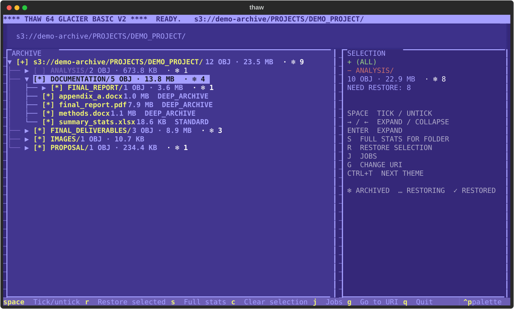

# thaw

Restore S3 objects from Glacier Deep Archive, track the restore, and copy the
restored objects to another bucket.



## Setup

```bash
cd ~/scripts/s3_glacier_restore
uv sync
uv run thaw --help
```

To run `thaw` from anywhere: `uv tool install --editable .` (jobs and config stay in this folder).

Credentials come from the normal boto3 chain. Set `profile` in `thaw.toml` or pass `--profile`.
The examples below use a made-up bucket `example-archive` and prefix `PROJECTS/DEMO_PROJECT/`.

## Typical workflow

### 1. Pick folders and request restores

Interactive:

```bash
uv run thaw browse s3://example-archive/PROJECTS/DEMO_PROJECT/
```

| Key | Action |
|---|---|
| space | tick / untick folder or file (ticking a folder selects everything beneath it) |
| → / ← / enter | expand / collapse |
| s | full stats for the highlighted folder (auto stats stop at 20,000 objects, shown as `+`) |
| r | restore selection → confirm dialog (tier, days, job name, cost estimate) |
| j | jobs screen |
| g | change URI |
| ctrl+t | next theme |

Untick a subfolder inside a ticked folder to exclude it; the parent then shows as partly ticked.
Labels show `obj · size · archived · restoring · restored` counts. Folder stats load in the
background (the first 200 sub-folders of each expanded folder); browsing and restoring never
wait for them. A folder shows at most 1,000 files; the rest are summarised in one line and are
still included when the folder is ticked.

Scriptable equivalent:

```bash
uv run thaw restore s3://example-archive/PROJECTS/DEMO_PROJECT/ --exclude ANALYSIS --dry-run
uv run thaw restore s3://example-archive/PROJECTS/DEMO_PROJECT/ --exclude ANALYSIS --name demo
```

`--include/--exclude` are globs matched against the first folder level under the
prefix (repeatable). `--deep` matches against the whole relative key instead.
`--tier Standard` (≤12 h) instead of the default Bulk (≤48 h, ~8× cheaper); `--days N`
sets how long restored copies stay readable (default 7).

### 2. Check progress

In the TUI jobs screen (`j`), press `u` to update status from S3. Or:

```bash
uv run thaw jobs
uv run thaw status demo            # HEADs objects whose state can still change, updates the job
uv run thaw status demo --errors   # objects with errors, conflicts or notes
```

`status` also prints **copy before: <date>**, the earliest expiry among restored objects that
haven't been copied yet. Copy before then, or the restore has to be paid for again.

### 3. Copy to another bucket

TUI jobs screen: `c` → destination (recent ones are offered), storage class, replace-existing.
Or:

```bash
uv run thaw copy demo s3://example-dest/restored/
```

- Server-side copy (nothing is downloaded); objects ≥ 8 MB use multipart copy (required > 5 GB).
  Object tags are carried over in both cases.
- Keys are kept relative to the job's base prefix:
  `…/DEMO_PROJECT/DOCUMENTATION/x.pdf` → `s3://example-dest/restored/DOCUMENTATION/x.pdf`.
  In the TUI the base is the deepest folder containing everything you ticked.
- Destination storage class defaults to STANDARD (`--storage-class`).
- **Existing destination objects are never replaced unless you ask.** Same size → counted as
  *already there*. Different size → *conflict*: left alone and listed by `status --errors`.
  Re-run with `--overwrite` (TUI: tick *Replace*) to replace them.
- Cross-region destinations, and destinations whose region can't be read, prompt first
  (`-y` to accept).
- Only readable objects are copied; re-run later for the rest.
- If a restored copy expired before it was copied, the object goes back to *pending*. Request it
  again with `thaw restore --job demo` (TUI: `p`), then copy once it's restored.

`copy` exits 1 when anything failed, conflicted or had expired, so scripts notice.

### Hands-off: watch and auto-copy

```bash
nohup uv run thaw watch demo --auto-copy s3://example-dest/restored/ --yes > jobs/demo.log 2>&1 &
```

Checks every `interval_minutes` (default 60) and copies objects as they become readable.
`--yes` accepts a cross-region destination up front; without it an unattended watch can't be
asked and won't start. Exit code 0 means everything is restored (and copied). Exit code 1 means
it stopped because something needs you:

- objects with no live restore (never requested, or the restored copy expired),
- failed restore requests, copy conflicts or failed copies,
- every status check failed,
- AWS credentials expired. Log in again and re-run; progress is kept.

It logs the reason and the command to run next.

## Stopping and resuming

Ctrl+C during `restore`, `status`, `copy` or `watch` stops sending requests, waits for the
few already in flight, records them in the job and exits (code 130). Re-run the same command
to carry on: restore requests and copies only act on objects that still need it.

## Permissions

Typical IAM policy (adjust bucket names and prefixes):

```json
{
  "Version": "2012-10-17",
  "Statement": [
    {"Effect": "Allow", "Action": ["s3:ListBucket", "s3:GetBucketLocation"],
     "Resource": "arn:aws:s3:::example-archive"},
    {"Effect": "Allow", "Action": ["s3:GetObject", "s3:RestoreObject", "s3:GetObjectTagging"],
     "Resource": "arn:aws:s3:::example-archive/PROJECTS/*"},
    {"Effect": "Allow", "Action": ["s3:ListBucket", "s3:GetBucketLocation"],
     "Resource": "arn:aws:s3:::example-dest"},
    {"Effect": "Allow", "Action": ["s3:GetObject", "s3:PutObject", "s3:PutObjectTagging",
                                   "s3:AbortMultipartUpload"],
     "Resource": "arn:aws:s3:::example-dest/restored/*"}
  ]
}
```

- `s3:ListBucket` on the **destination** matters. Without it S3 answers 403 instead of 404 for
  missing keys. thaw then can't tell whether an object is already there, so it refuses to copy
  rather than risk overwriting.
- SSE-KMS buckets also need `kms:Decrypt` on the source key and `kms:GenerateDataKey` on the
  destination key.
- `restore`, `status` and browsing only need the source statements. `copy` and `watch --auto-copy`
  need both.

## Themes

Default is `eightbit`. Others: `amber`, `phosphor`, `dos`, `synthwave`, `textual-dark` (plain).
Set `[ui] theme` in `thaw.toml`, pass `thaw browse --theme NAME`, or press Ctrl+T in the app to cycle.
Previews: [docs/themes/index.html](docs/themes/index.html).

## Jobs

Each job is `jobs/<name>.sqlite` (per-object restore and copy state) plus
`jobs/<name>.summary.json`. `jobs/` is git-ignored.

Where `jobs/`, `thaw.toml` and the recent-destinations file live:

1. `$THAW_HOME`, if set (`$THAW_CONFIG` can point at a different `thaw.toml`);
2. otherwise this checkout, when run with `uv run` or after `uv tool install --editable .`;
3. otherwise `~/.local/share/thaw` (or `$XDG_DATA_HOME/thaw`), e.g. after a non-editable install.

`--job` and the job arguments take a job name; a path to a `.sqlite` job file also works.

## Notes

- Standard/IA/Glacier IR objects in a selection need no restore and are copied as-is.
  Glacier Flexible Retrieval objects are restored like Deep Archive ones.
- Intelligent-Tiering objects in the opt-in archive tiers are not detected; their copy
  fails with `InvalidObjectState` (visible via `--errors`).
- Prices in `thaw.toml` are approximate, for the estimate only.
- Selections over `warn_objects` (50,000) trigger a warning; S3 Batch Operations
  would be cheaper and faster for jobs that big (not implemented).
- Object names are shown with control characters escaped (`\x1b`) and never interpreted as
  markup, so odd or hostile key names can't mess with the terminal or the UI.

## Tests

```bash
uv run pytest
```

Uses moto (mocked S3), so no real restores are ever requested.
